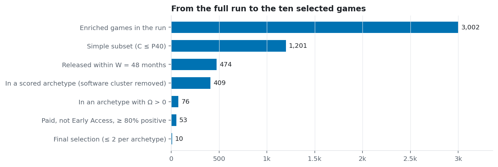
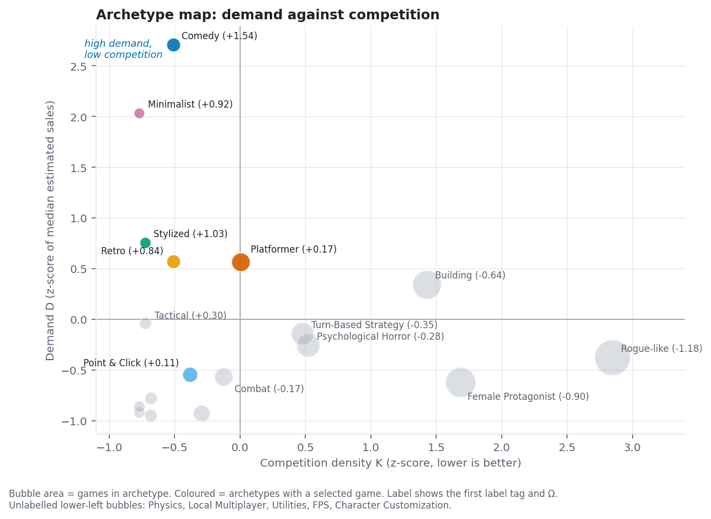
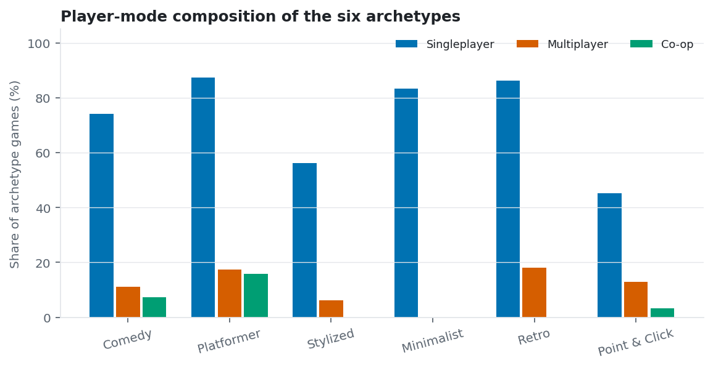
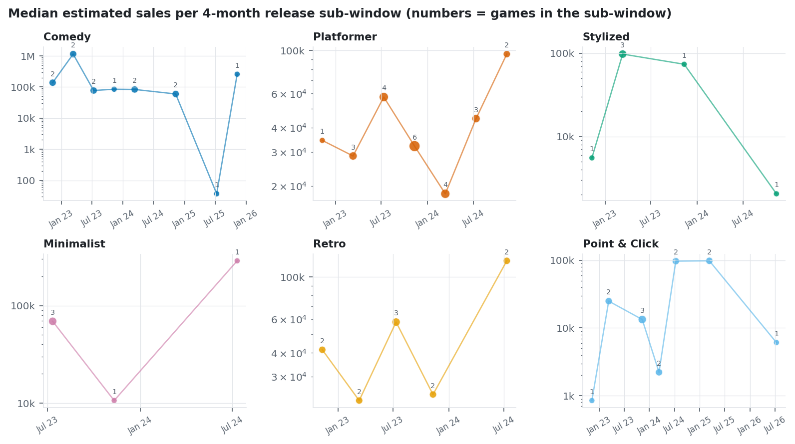
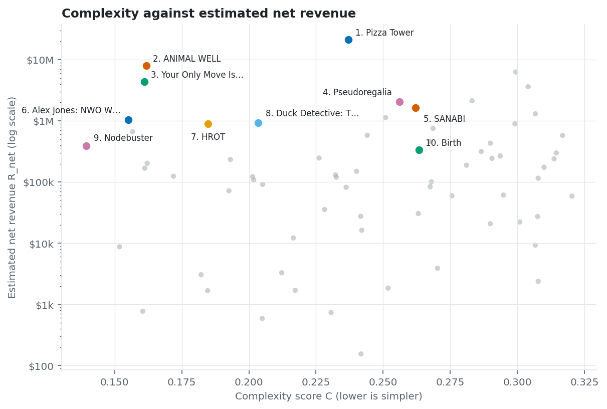
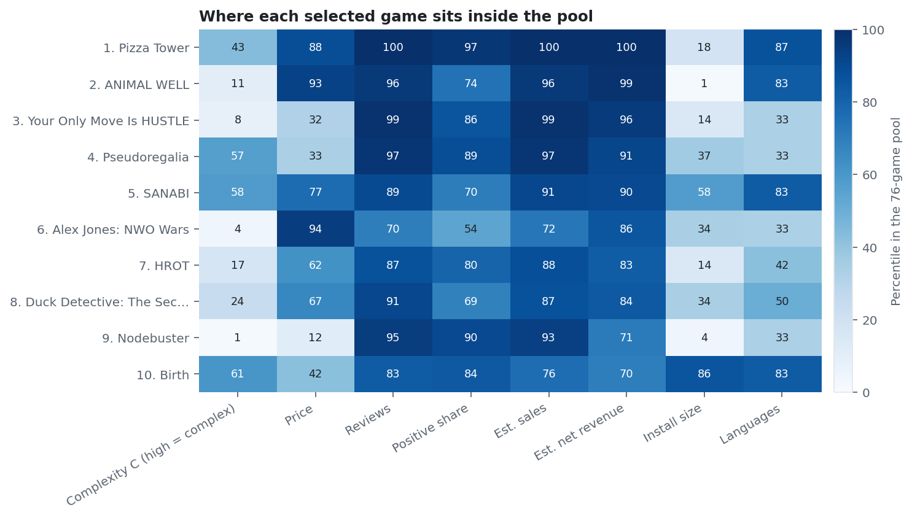
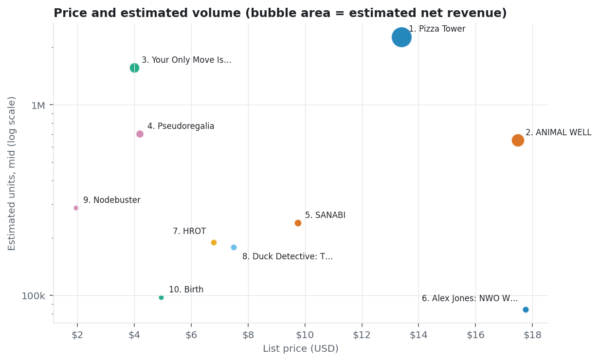
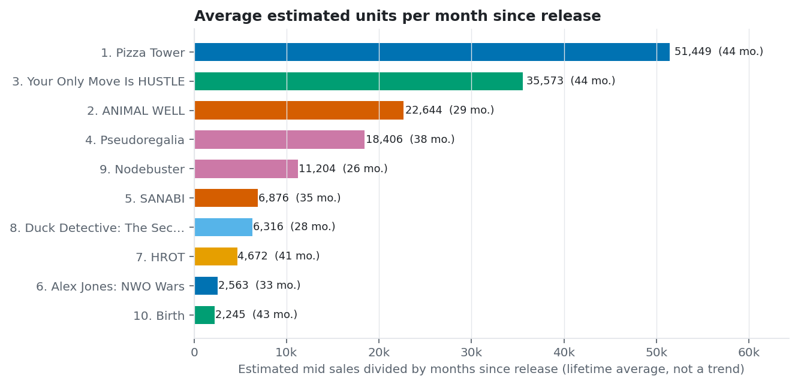
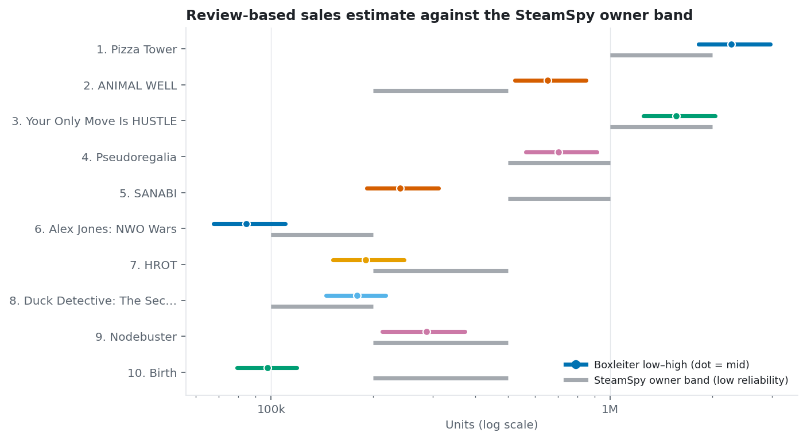

# Top 10 Games Under the Current Analysis

Report generated from stored run `20261003T204134704Z-d8d2b3` (large scan, 10 catalog pages, W=48), started 2026-10-03 and finished 2026-10-06.
All figures are derived from the stored data. No new network requests were made. Regenerate with
`python scripts/build_top10_report.py --db data/analyses.db`.

## 1. Summary

The ten games were chosen from the 1,201-game simple subset of the run (complexity score C in the bottom 40%).
Each of them was released within the 48-month window, belongs to an archetype with a positive opportunity score Ω,
is paid, has left Early Access, and has at least 80% positive reviews. They were ranked by the effort-adjusted return E
of FORMULATION §5, with at most two games per archetype.

- The selection covers six archetypes: Comedy, Platformer, Stylized, Minimalist, Retro, Point & Click. The two archetypes with the largest Ω are Comedy (+1.54) and Stylized (+1.03).
- Together the ten games account for roughly 6.27M estimated units and $41.00M estimated net revenue. Pizza Tower alone contributes 52% of that revenue, so the totals are dominated by one title.
- The median list price of the selection is $7.14 and the median C is 0.194, against a median C of 0.245 for the 76-game pool the selection was drawn from.
- 8 of the 10 are self-published (developer and publisher fields are identical) and 4 list a single language, which may suggest that wide localization was not a precondition for these results.
- The review-based unit estimate falls within the SteamSpy owner band for 4 games, above it for 2 and below it for 4. The estimates are therefore consistent with an ordinal ranking and should not be quoted as sales figures (§7).
- The archetypes behind the selection are small (5 to 23 games each). Their Ω values may change noticeably with a larger sample, so the archetype-level conclusions are weaker than the game-level observations.

## 2. Data and Selection Rule

The run scanned 3,002 enriched games. SteamSpy's bulk list is ordered by owner count, and the 10 catalog pages
used here end in the 50,000–100,000 owner band. Every game in the run is therefore already a game that reached at least
that audience size, which matters for how the demand scores can be read (§7).

The selection rule uses only quantities already produced by the pipeline.

1. **Simple subset.** C at or below the 40th percentile of the run (0.321), as locked in FORMULATION §3a.
2. **Recent.** Released on or after 2022-10-03 (48 months before the run start, the window W of FORMULATION §6).
3. **Scored archetype with Ω > 0.** The software-like cluster "Utilities / Software / Design & Illustration" is removed (todo.md item 9).
4. **Paid, finished, well received.** Free-to-play titles have no revenue estimate, Early Access titles are unfinished, and a positive review share below 80% is treated as weak evidence of product quality.
5. **Ranking.** Effort-adjusted return E = R_net / (C + 0.05). At most 2 games per archetype so that one archetype does not fill the list.

Restricting the pool to archetypes with Ω > 0 follows the research question of the project, which asks where demand is
high and competition is low. The strongest games of the other archetypes are listed in §6 so that they are not lost.

## 3. Archetype Context

| Archetype | Games | D | K | Σ | Ω | Median est. units | Median C | Singleplayer / Multiplayer / Co-op share | Selected games |
|---|---|---|---|---|---|---|---|---|---|
| Comedy / Dark Humor / Dark Comedy | 11 | +2.71 | -0.51 | +1.00 | +1.54 | 84,550 | 0.237 | 74% / 11% / 7% | Pizza Tower, Alex Jones: NWO Wars |
| Platformer / 2D Platformer / Side Scroller | 23 | +0.57 | +0.00 | -0.17 | +0.17 | 35,261 | 0.262 | 87% / 17% / 16% | ANIMAL WELL, SANABI |
| Stylized / Hand-drawn / Cartoony | 6 | +0.76 | -0.73 | +1.69 | +1.03 | 39,618 | 0.222 | 56% / 6% / 0% | Your Only Move Is HUSTLE, Birth |
| Minimalist / Surreal / Psychedelic | 5 | +2.04 | -0.77 | -0.43 | +0.92 | 69,050 | 0.267 | 83% / 0% / 0% | Pseudoregalia, Nodebuster |
| Retro / Old School / 1990's | 11 | +0.57 | -0.51 | +1.51 | +0.84 | 35,372 | 0.226 | 86% / 18% / 0% | HROT |
| Point & Click / Investigation / Cyberpunk | 14 | -0.54 | -0.38 | +0.69 | +0.11 | 9,725 | 0.244 | 45% / 13% / 3% | Duck Detective: The Secret Salami |

D, K and Σ are z-scores of median estimated units, release count in the window and one minus median C. Ω = 0.40·D − 0.30·K + 0.30·Σ (FORMULATION §6).

The archetypes of this selection are mostly single-player. Only Comedy (11%), Platformer (17%), Retro (18%) and Point & Click (13%) show a multiplayer share above 10%.

Each point is the median of at most six games, so the lines are descriptive only. FORMULATION §6 states that no significance claim is attached to these slopes.

## 4. The Ten Games at a Glance

| # | Game | Archetype | Release | Price | Reviews (pos.) | Est. units (mid) | Est. net revenue | C | E (M) |
|---|---|---|---|---|---|---|---|---|---|
| 1 | Pizza Tower | Comedy | 2023-01 | $13.39 | 45,503 (98%) | 2.28M | $21.32M | 0.237 | 74.3 |
| 2 | ANIMAL WELL | Platformer | 2024-05 | $17.49 | 13,049 (95%) | 652k | $7.99M | 0.162 | 37.7 |
| 3 | Your Only Move Is HUSTLE | Stylized | 2023-02 | $3.99 | 31,298 (97%) | 1.56M | $4.37M | 0.161 | 20.7 |
| 4 | Pseudoregalia | Minimalist | 2023-07 | $4.19 | 14,066 (97%) | 703k | $2.06M | 0.256 | 6.7 |
| 5 | SANABI | Platformer | 2023-11 | $9.74 | 4,789 (95%) | 239k | $1.63M | 0.262 | 5.2 |
| 6 | Alex Jones: NWO Wars | Comedy | 2024-01 | $17.76 | 1,691 (92%) | 85k | $1.05M | 0.155 | 5.1 |
| 7 | HROT | Retro | 2023-05 | $6.79 | 3,794 (96%) | 190k | $902k | 0.185 | 3.8 |
| 8 | Duck Detective: The Secret Salami | Point & Click | 2024-05 | $7.49 | 4,840 (95%) | 179k | $939k | 0.203 | 3.7 |
| 9 | Nodebuster | Minimalist | 2024-08 | $1.94 | 10,648 (97%) | 287k | $390k | 0.139 | 2.1 |
| 10 | Birth | Stylized | 2023-02 | $4.94 | 2,639 (97%) | 98k | $338k | 0.263 | 1.1 |

The percentile columns compare each game with the 76 games of the pool. For the complexity column a high percentile means a more complex game.

The monthly average divides lifetime estimated units by months since release. It hides the usual launch-heavy sales curve, so older games look slower than their current rate.

## 5. Game-by-Game Analysis

### 1. Pizza Tower

| | | | |
|---|---|---|---|
| Developer / publisher | Tour De Pizza / Tour De Pizza | Release | Jan 26, 2023 (44 months before the run) |
| Archetype (Ω) | Comedy (+1.54, 11 games) | List price | $13.39 |
| Reviews / positive share | 45,503 / 98.4% | Estimated units low / mid / high | 1.82M / 2.28M / 2.96M |
| Estimated net revenue | $21.32M | Effort-adjusted return E | 74.3M |
| Complexity score C | 0.237 (37th percentile of the 1,201 simple games, 43rd of the 76-game pool) | SteamSpy owners | 1,000,000 .. 2,000,000, Boxleiter mid is **above** the band |
| Average units per month | 51,449 | Install size / minimum RAM | 300 MB / 512 MB |
| Languages / achievements / DLC / platforms | 12 / 74 / 1 / 1 | Player modes (Steam categories) | Single-player, Multi-player, Co-op |

Most-voted tags: Great Soundtrack (980), 2D Platformer (913), Fast-Paced (855), Indie (838), Cartoony (813), Platformer (671), Funny (661), Singleplayer (631).

Archetype label tags carried by this game: Comedy (625), Dark Humor (not in stored tags), Dark Comedy (not in stored tags).

- It has the largest estimated net revenue of the 76-game pool (about $21.3M) at a C of 0.237, which is the 43rd percentile and not the low end. The position comes from volume and not from a very low complexity score.
- Its 2.28M estimated units are about 27 times the median of the Comedy archetype (84,550 units). The archetype's demand score is a median and does not describe a typical member, so this title behaves as an outlier inside its archetype.
- The Boxleiter mid estimate lies above the SteamSpy owner band (1M to 2M), so the revenue figure may be overstated.
- The most-voted tags are Great Soundtrack (980 votes), 2D Platformer, Fast-Paced, Cartoony and Funny. The data cannot separate the contribution of audio, art style and gameplay to its reception.
- The price of $13.39 is at the 88th percentile of the pool and the game still ranks first in review count, which may suggest that demand for it was not strongly price-limited.

**Reading for a small team.** It may indicate that a stylized 2D platformer with a strong audio and visual identity can reach a large audience at a mid price. As a template it carries survivorship risk, because it is a single outlier of its archetype.

### 2. ANIMAL WELL

| | | | |
|---|---|---|---|
| Developer / publisher | Billy Basso / Bigmode | Release | May 9, 2024 (29 months before the run) |
| Archetype (Ω) | Platformer (+0.17, 23 games) | List price | $17.49 |
| Reviews / positive share | 13,049 / 95.3% | Estimated units low / mid / high | 522k / 652k / 848k |
| Estimated net revenue | $7.99M | Effort-adjusted return E | 37.7M |
| Complexity score C | 0.162 (7th percentile of the 1,201 simple games, 11th of the 76-game pool) | SteamSpy owners | 200,000 .. 500,000, Boxleiter mid is **above** the band |
| Average units per month | 22,644 | Install size / minimum RAM | 35 MB / 1.0 GB |
| Languages / achievements / DLC / platforms | 11 / 20 / 0 / 1 | Player modes (Steam categories) | Single-player |

Most-voted tags: Metroidvania (303), Exploration (297), Puzzle (263), Pixel Graphics (258), Puzzle-Platformer (257), Horror (217), Platformer (211), 2D (203).

Archetype label tags carried by this game: Platformer (211), 2D Platformer (not in stored tags), Side Scroller (not in stored tags).

- The 35 MB install size is the 1st percentile of the pool and is the main reason for its low C of 0.162. This probably does not reflect production effort, because install size also depends on how assets are generated and compressed.
- At $17.49 it is at the 93rd percentile of price, with 13,049 reviews and 95.3% positive. A premium price was therefore compatible with a strong reception in this archetype.
- The mid estimate of 652k units is above the SteamSpy band (200k to 500k), so the true figure may be closer to the band.
- It is published by Bigmode and is not self-published. It carries only one of the three label tags of its archetype (Platformer), and its most-voted tags are Metroidvania, Exploration and Puzzle.
- The Platformer archetype has 23 games and Ω = +0.17, the weakest positive score among the six archetypes except Point & Click.

**Reading for a small team.** The commercial result is clear in the data, but its C is the least trustworthy of the ten. It is better read as evidence that a premium-priced puzzle-platformer can sell well than as a low-effort template.

### 3. Your Only Move Is HUSTLE

| | | | |
|---|---|---|---|
| Developer / publisher | Ivy Sly / Ivy Sly | Release | Feb 2, 2023 (44 months before the run) |
| Archetype (Ω) | Stylized (+1.03, 6 games) | List price | $3.99 |
| Reviews / positive share | 31,298 / 96.8% | Estimated units low / mid / high | 1.25M / 1.56M / 2.03M |
| Estimated net revenue | $4.37M | Effort-adjusted return E | 20.7M |
| Complexity score C | 0.161 (7th percentile of the 1,201 simple games, 8th of the 76-game pool) | SteamSpy owners | 1,000,000 .. 2,000,000, Boxleiter mid is **within** the band |
| Average units per month | 35,573 | Install size / minimum RAM | 256 MB / 512 MB |
| Languages / achievements / DLC / platforms | 1 / 22 / 0 / 2 | Player modes (Steam categories) | Single-player, Multi-player, PvP, Online PvP |

Most-voted tags: 2D Fighter (344), Turn-Based Strategy (289), Action (266), Strategy (252), Spectacle fighter (234), Turn-Based Tactics (227), 2D (226), Pixel Graphics (221).

Archetype label tags carried by this game: Stylized (not in stored tags), Hand-drawn (130), Cartoony (146).

- At $3.99 it has an estimated 1.56M units, and the mid estimate lies within the SteamSpy band (1M to 2M). This is the best corroborated of the three highest-ranked games, since the first two lie above their bands.
- C is 0.161 (8th percentile of the pool). The game lists one language, 22 achievements and no DLC, and its categories include Online PvP and LAN PvP.
- The most-voted tags are 2D Fighter, Turn-Based Strategy, Spectacle fighter and Sandbox. It combines two genres that are usually separate, and its archetype assignment rests on Hand-drawn (130 votes) and Cartoony (146 votes), which rank lower among its tags.
- Online and local multiplayer modes may add networking and balancing work that the complexity score does not fully capture.

**Reading for a small team.** The low price and the large estimated volume may suggest a volume-driven pricing approach. The multiplayer component makes the effort for a small team uncertain.

### 4. Pseudoregalia

| | | | |
|---|---|---|---|
| Developer / publisher | rittzler / rittzler | Release | Jul 28, 2023 (38 months before the run) |
| Archetype (Ω) | Minimalist (+0.92, 5 games) | List price | $4.19 |
| Reviews / positive share | 14,066 / 97.1% | Estimated units low / mid / high | 563k / 703k / 914k |
| Estimated net revenue | $2.06M | Effort-adjusted return E | 6.7M |
| Complexity score C | 0.256 (48th percentile of the 1,201 simple games, 57th of the 76-game pool) | SteamSpy owners | 500,000 .. 1,000,000, Boxleiter mid is **within** the band |
| Average units per month | 18,406 | Install size / minimum RAM | 600 MB / 8.0 GB |
| Languages / achievements / DLC / platforms | 1 / n/a / 1 / 1 | Player modes (Steam categories) | Single-player |

Most-voted tags: 3D Platformer (310), Metroidvania (281), Female Protagonist (241), Parkour (237), Exploration (232), Platformer (215), Old School (208), 3D (194).

Archetype label tags carried by this game: Minimalist (not in stored tags), Surreal (160), Psychedelic (not in stored tags). Imputed complexity inputs: achievement_count.

- At $4.19 and with 14,066 reviews (97.1% positive) it has an estimated 703k units, within the SteamSpy band (500k to 1M).
- C is 0.256. The minimum RAM requirement is 8 GB and the install size is 600 MB. The achievement count is missing in the stored data and was imputed.
- It is a 3D platformer with Metroidvania, Parkour and Old School tags. Its only stored label tag of the Minimalist archetype is Surreal (160 votes), so the archetype fit is loose.
- The Minimalist archetype holds exactly 5 games, which is the scoring floor, and its D of +2.04 rests on a median of five values.

**Reading for a small team.** The game may show that a low-priced 3D platformer can reach a large audience. The archetype it sits in has the thinnest evidence of the six.

### 5. SANABI

| | | | |
|---|---|---|---|
| Developer / publisher | WONDER POTION / NEOWIZ | Release | Nov 8, 2023 (35 months before the run) |
| Archetype (Ω) | Platformer (+0.17, 23 games) | List price | $9.74 |
| Reviews / positive share | 4,789 / 95.0% | Estimated units low / mid / high | 192k / 239k / 311k |
| Estimated net revenue | $1.63M | Effort-adjusted return E | 5.2M |
| Complexity score C | 0.262 (52nd percentile of the 1,201 simple games, 58th of the 76-game pool) | SteamSpy owners | 500,000 .. 1,000,000, Boxleiter mid is **below** the band |
| Average units per month | 6,876 | Install size / minimum RAM | 1.0 GB / 4.0 GB |
| Languages / achievements / DLC / platforms | 11 / 21 / 2 / 1 | Player modes (Steam categories) | Single-player |

Most-voted tags: Pixel Graphics (288), Story Rich (265), Action (247), Cyberpunk (221), Adventure (191), 2D Platformer (177), Singleplayer (166), Action-Adventure (165).

Archetype label tags carried by this game: Platformer (153), 2D Platformer (177), Side Scroller (83).

- The developer (WONDER POTION) and the publisher (NEOWIZ) differ, so this is not a self-published result.
- The estimated 239k units are below the SteamSpy band (500k to 1M), which suggests that the review-based figure may be conservative or that the band overstates the audience.
- It lists 11 languages and 21 achievements. The 1 GB install size is at the 58th percentile of the pool. C is 0.262.
- Among its tags, Pixel Graphics, Story Rich and Cyberpunk have the most votes. It carries all three label tags of the Platformer archetype.

**Reading for a small team.** It has a more conventional production profile than the games above, with localization and a publisher. It may be a less direct reference for a very small self-funded team.

### 6. Alex Jones: NWO Wars

| | | | |
|---|---|---|---|
| Developer / publisher | NWO Wars Team / NWO Wars Team | Release | Jan 3, 2024 (33 months before the run) |
| Archetype (Ω) | Comedy (+1.54, 11 games) | List price | $17.76 |
| Reviews / positive share | 1,691 / 91.8% | Estimated units low / mid / high | 68k / 85k / 110k |
| Estimated net revenue | $1.05M | Effort-adjusted return E | 5.1M |
| Complexity score C | 0.155 (4th percentile of the 1,201 simple games, 4th of the 76-game pool) | SteamSpy owners | 100,000 .. 200,000, Boxleiter mid is **below** the band |
| Average units per month | 2,563 | Install size / minimum RAM | 500 MB / 2.0 GB |
| Languages / achievements / DLC / platforms | 1 / n/a / 0 / 1 | Player modes (Steam categories) | Single-player |

Most-voted tags: Action (279), Arcade (252), Shooter (247), 2D Platformer (245), Shoot 'Em Up (235), Side Scroller (230), 2D (219), Cartoony (210).

Archetype label tags carried by this game: Comedy (181), Dark Humor (158), Dark Comedy (not in stored tags). Imputed complexity inputs: achievement_count.

- C is 0.155 (4th percentile of the pool) and the game lists one language. The achievement count is missing in the stored data and was imputed.
- At $17.76 it has the highest price of the selection and an estimated 84.6k units, below the SteamSpy band (100k to 200k).
- It is a 2D side-scrolling shooter with Conspiracy and America tags. The title refers to a public figure, and the data cannot separate audience that follows that figure from audience for the genre.
- Only 1,691 reviews support its estimate, the smallest review base of the ten, so its ranking is the least stable.

**Reading for a small team.** Its replicability may be limited if a significant share of demand depended on the associated public figure. The data cannot confirm this.

### 7. HROT

| | | | |
|---|---|---|---|
| Developer / publisher | Spytihněv / Spytihněv | Release | May 16, 2023 (41 months before the run) |
| Archetype (Ω) | Retro (+0.84, 11 games) | List price | $6.79 |
| Reviews / positive share | 3,794 / 96.1% | Estimated units low / mid / high | 152k / 190k / 247k |
| Estimated net revenue | $902k | Effort-adjusted return E | 3.8M |
| Complexity score C | 0.185 (14th percentile of the 1,201 simple games, 17th of the 76-game pool) | SteamSpy owners | 200,000 .. 500,000, Boxleiter mid is **below** the band |
| Average units per month | 4,672 | Install size / minimum RAM | 256 MB / 2.0 GB |
| Languages / achievements / DLC / platforms | 2 / 55 / 0 / 1 | Player modes (Steam categories) | Single-player |

Most-voted tags: Retro (277), FPS (251), Shooter (169), Boomer Shooter (166), Indie (149), First-Person (149), Action (144), Singleplayer (143).

Archetype label tags carried by this game: Retro (277), Old School (136), 1990's (not in stored tags).

- At $6.79 it has 3,794 reviews (96.1% positive) and an estimated 190k units, which is about 5 times the median of the Retro archetype (35,372 units). The mid estimate sits just below the SteamSpy band (200k to 500k) and its low-to-high range (152k to 247k) overlaps it.
- C is 0.185 (17th percentile of the pool). It lists 2 languages, 55 achievements, Steam Trading Cards and a long list of accessibility options.
- The most-voted tags are Retro, FPS, Shooter and Boomer Shooter, so it sits in a defined niche whose audience identifies the genre by name.
- Developer and publisher are the same name, which suggests a self-published release.

**Reading for a small team.** It is a compact retro shooter with a modest price, and the data may suggest that a clearly named niche can support a self-published release of this size.

### 8. Duck Detective: The Secret Salami

| | | | |
|---|---|---|---|
| Developer / publisher | Happy Broccoli Games / Happy Broccoli Games | Release | May 23, 2024 (28 months before the run) |
| Archetype (Ω) | Point & Click (+0.11, 14 games) | List price | $7.49 |
| Reviews / positive share | 4,840 / 95.0% | Estimated units low / mid / high | 145k / 179k / 218k |
| Estimated net revenue | $939k | Effort-adjusted return E | 3.7M |
| Complexity score C | 0.203 (21st percentile of the 1,201 simple games, 24th of the 76-game pool) | SteamSpy owners | 100,000 .. 200,000, Boxleiter mid is **within** the band |
| Average units per month | 6,316 | Install size / minimum RAM | 500 MB / 1.0 GB |
| Languages / achievements / DLC / platforms | 4 / 7 / 1 / 3 | Player modes (Steam categories) | Single-player |

Most-voted tags: Detective (131), Investigation (107), Casual (106), Short (98), Cute (96), Adventure (94), Noir (85), Mystery (83).

Archetype label tags carried by this game: Point & Click (72), Investigation (107), Cyberpunk (not in stored tags).

- At $7.49 it has 4,840 reviews (95.0% positive) and an estimated 179k units, within the SteamSpy band (100k to 200k). That is about 18 times the median of the Point & Click archetype (9,725 units).
- The Point & Click archetype has Ω = +0.11, the weakest positive score of the six, so the game is a strong member of a weakly supported archetype.
- The tags include Detective, Investigation, Casual, Short (98 votes), Cute and Noir. A short length may keep scope small.
- It lists three platforms, the only one of the ten to do so, and 19 Steam category entries, most of them accessibility and controller options. It has only 7 achievements and 4 languages.

**Reading for a small team.** The data may suggest that a short, tightly scoped narrative game can reach a mid-sized audience. Its C is raised somewhat by the three-platform release.

### 9. Nodebuster

| | | | |
|---|---|---|---|
| Developer / publisher | Goblobin / Goblobin | Release | Aug 13, 2024 (26 months before the run) |
| Archetype (Ω) | Minimalist (+0.92, 5 games) | List price | $1.94 |
| Reviews / positive share | 10,648 / 97.2% | Estimated units low / mid / high | 213k / 287k / 373k |
| Estimated net revenue | $390k | Effort-adjusted return E | 2.1M |
| Complexity score C | 0.139 (1st percentile of the 1,201 simple games, 1st of the 76-game pool) | SteamSpy owners | 200,000 .. 500,000, Boxleiter mid is **within** the band |
| Average units per month | 11,204 | Install size / minimum RAM | 100 MB / 4.0 GB |
| Languages / achievements / DLC / platforms | 1 / 13 / 0 / 1 | Player modes (Steam categories) | Single-player |

Most-voted tags: Casual (252), Clicker (240), Strategy (238), Idler (227), Simulation (222), Arcade (196), Management (186), 2D (180).

Archetype label tags carried by this game: Minimalist (140), Surreal (not in stored tags), Psychedelic (not in stored tags).

- At $1.94 it has 10,648 reviews (97.2% positive) and an estimated 287k units, within the SteamSpy band (200k to 500k). The estimated net revenue of about $390k is the second smallest of the ten, so its E rank is lifted mainly by the lowest C of the selection (0.139, 1st percentile of the pool).
- It is a clicker and idle game (Clicker, Idler, Strategy, Casual). It lists one language and a 100 MB install size.
- It shares the Minimalist archetype with Pseudoregalia although the two games have little in common in design. The archetype is a cluster of similar tag sets and not a design lineage.

**Reading for a small team.** It may suggest that a very low-price, low-scope game can still reach a large number of buyers. The absolute revenue is small, so it points to a different business outcome than the games above.

### 10. Birth

| | | | |
|---|---|---|---|
| Developer / publisher | Madison Karrh / Madison Karrh | Release | Feb 17, 2023 (43 months before the run) |
| Archetype (Ω) | Stylized (+1.03, 6 games) | List price | $4.94 |
| Reviews / positive share | 2,639 / 96.8% | Estimated units low / mid / high | 79k / 98k / 119k |
| Estimated net revenue | $338k | Effort-adjusted return E | 1.1M |
| Complexity score C | 0.263 (53rd percentile of the 1,201 simple games, 61st of the 76-game pool) | SteamSpy owners | 200,000 .. 500,000, Boxleiter mid is **below** the band |
| Average units per month | 2,245 | Install size / minimum RAM | 2.0 GB / n/a |
| Languages / achievements / DLC / platforms | 11 / 7 / 0 / 2 | Player modes (Steam categories) | Single-player |

Most-voted tags: Point & Click (142), Surreal (137), Puzzle (132), Relaxing (128), Hidden Object (124), Stylized (110), Atmospheric (109), Hand-drawn (108).

Archetype label tags carried by this game: Stylized (110), Hand-drawn (108), Cartoony (not in stored tags). Imputed complexity inputs: ram_bytes.

- At $4.94 it has 2,639 reviews (96.8% positive) and an estimated 97.6k units, below the SteamSpy band (200k to 500k). Its estimated net revenue of about $338k is the smallest of the ten.
- C is 0.263 (61st percentile of the pool) with a 2 GB install size, which is the 86th percentile of the pool. The RAM requirement was imputed.
- The most-voted tags are Point & Click, Surreal, Puzzle, Relaxing and Hidden Object. It carries Stylized (110 votes) and Hand-drawn (108 votes) of its archetype's label tags.
- The Stylized archetype has 6 games and its median is 39,617 units, so Birth is about 2.5 times the median.

**Reading for a small team.** It is on the list because of the two-games-per-archetype rule and carries the weakest evidence of the ten. It should be read as a modest, low-risk result.

## 6. Sensitivity and Games Outside the Selection

**Early Access.** If Early Access titles were allowed, Selaco and Psycho Patrol R would enter the list
and Nodebuster and Birth would leave it. The Early Access titles that would enter are priced at Selaco ($24.99) and Psycho Patrol R ($31.99), which is above the median price of the current selection.

**Games with high E in archetypes with Ω ≤ 0.** These games have not been selected because their archetypes are crowded or have lower demand
by the run's own measure. Several of them are large commercial results, so the table is informative about what is possible even where the
archetype score is unfavourable.

| Game | Archetype (Ω) | Est. units (mid) | Est. net revenue | C | E (M) | Early Access |
|---|---|---|---|---|---|---|
| Schedule I | Building (-0.64) | 10.11M | $99.01M | 0.311 | 274.6 | yes |
| DELTARUNE | Psychological Horror (-0.28) | 3.22M | $56.36M | 0.307 | 158.1 | no |
| Gorilla Tag | Physics (-0.58) | 2.39M | $33.41M | 0.200 | 133.6 | no |
| Balatro | Turn-Based Strategy (-0.35) | 2.83M | $23.72M | 0.228 | 85.4 | no |
| SIGNALIS | Psychological Horror (-0.28) | 1.08M | $10.54M | 0.239 | 36.5 | no |
| Dwarf Fortress | Building (-0.64) | 652k | $10.95M | 0.269 | 34.3 | no |
| My Summer Car | Building (-0.64) | 1.01M | $10.55M | 0.283 | 31.7 | no |
| The Coffin of Andy and Leyley | Female Protagonist (-0.90) | 704k | $3.96M | 0.137 | 21.1 | yes |

The complexity score is built from metadata such as install size, achievement count and developer catalog size. For some of these titles it may understate
the effort of building them. Dwarf Fortress, for example, is a long-running project whose Steam release is a later edition, and DELTARUNE continues a franchise with an existing audience.
These two remarks come from general knowledge of the titles and not from the pipeline data.

## 7. Limitations

1. **Unit estimates.** Units are review counts multiplied by genre-bucket factors (FORMULATION §2). The source cited there reports that only about 43% of games fall within ±30% of true sales under this method. Net revenue also applies no discount or refund shrinkage (δ = ρ = 0), so it probably overstates take-home revenue.
2. **SteamSpy owner bands.** The bands are coarse and have low reliability after 2018 (ARCHITECTURE.md, limitation 1). They are shown only as a plausibility check.
3. **Complexity score.** C is a proxy based on store metadata. It does not measure development time. Animal Well has an install size at the 1st percentile of the pool, which lowers its C, and this is unlikely to reflect its production effort.
4. **Sample selected on outcome.** All games already fall in a SteamSpy owner band of at least 50,000 owners. Archetype demand is therefore conditional on commercial survival, and no failure rate can be derived from this run.
5. **Archetype assignment.** Games are assigned to an archetype by plurality vote over non-generic tags. Games with different design (Pseudoregalia and Nodebuster in the Minimalist archetype, Pizza Tower in Comedy) can share an archetype, and the label describes the three most co-occurring tags, not the game.
6. **Small groups.** Archetypes hold 5 to 23 games in the window. The minimum of 5 is the floor of the scoring rule, and Minimalist sits exactly on it.
7. **Parameters.** `parameters_version` of all rows is `aec07e849037`. The run's window and clustering threshold were changed after earlier runs (todo.md items 6 and 7), so Ω values may not be comparable with earlier runs.
8. **Single run.** The result describes one scan taken on 2026-10-03. A later scan can change the ranking.

## 8. Files

- `rapor.md` is this report and `rapor_assets/` holds the nine figures.
- `scripts/top10_data.py` applies the selection rule, `scripts/top10_figures.py` draws the figures, `scripts/top10_notes.py` holds the per-game commentary and `scripts/build_top10_report.py` assembles the report.
